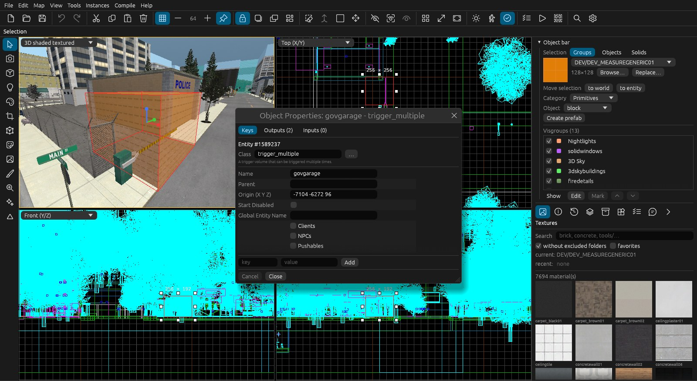
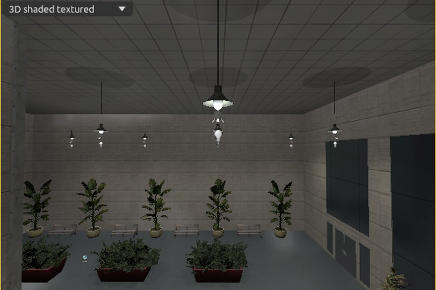
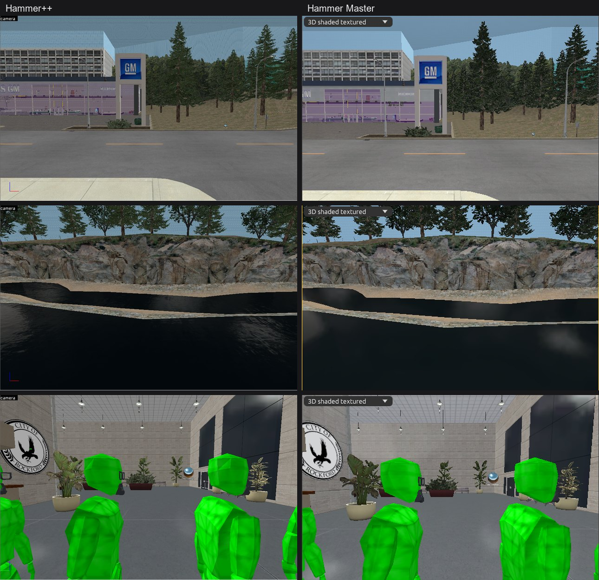
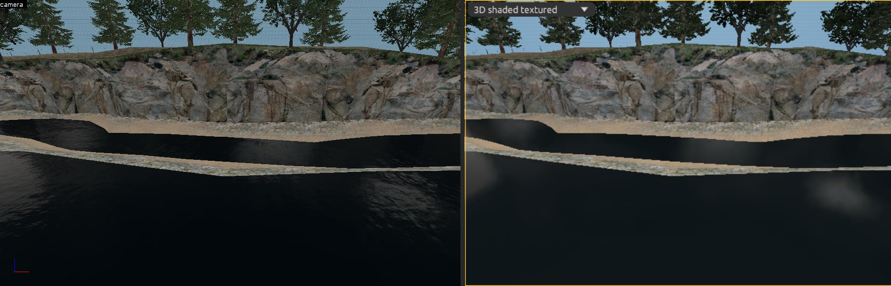

<div align="center">

# Hammer Master

**A map editor for the Source engine and Garry's Mod, written in Rust.**<br>
It reads and writes Hammer++ `.vmf` files byte for byte, shows the map the way the game draws it,<br>
checks it while you build, and can also be driven over MCP.

[](LICENSE)




</div>

---

## At a glance

Hammer Master keeps the Hammer++ workflow: one 3D view, three 2D views, the object bar and the same shortcuts. On top of
that it adds what a large map needs: a game-accurate renderer, continuous checking and command-line tools.

- **Lossless**: a Hammer++ VMF opened and saved again comes out byte for byte identical. VMFs saved by Hammer Master
  reopen in Hammer++ without a single warning.
- **Everything can be undone**: every change, whether it comes from the mouse, the keyboard, the command line or an MCP
  client, is one step of an unlimited history (Ctrl+Z).
- **The real game files**: models, materials and textures are read from the folders and VPK archives of Garry's Mod
  and its addons, the same way the engine does it.

> The user interface is available in English and French: **Tools → Options → Langue / Language**. On first launch it
> follows the Windows display language. Some messages from the map checks and the command history are still in French.

## Features

### Editing

- Hammer tools: selection (groups, objects or single solids), block and primitives (cylinder, spike, sphere, arch,
  stairs, wedge), entities, textures (apply, align, justify, replace), clipping, vertex editing.
- Displacements: create, sculpt, paint alpha, sew.
- Decals and overlays placed with one click on a face.
- Visgroups (including automatic ones), multiple cordons, groups, prefabs, `func_instance` drawn in place.
- "Object Properties" window on double click: FGD keys, flags, outputs and inputs.
- Hammer++ tools: prop sprinkling, polygon, magnifier, eyedropper, local or global gizmo.
- Propper: turn brushes into a `.mdl` model compiled by studiomdl.
- Autosave and crash recovery.

### See the map as the game draws it

- Models with their skins, bodygroups and the pose of their first sequence; translucent, alpha-tested and blended
  (`WorldVertexTransition`) materials.
- `$envmap` reflections on water, glass and floors, with the engine's masks.
- 2D sky and 3D skybox (Alt+V).
- Lighting preview (Ctrl+F5): the map's lights, spotlights, sun and sky, with shadows.
- FGD helpers: icons, entity links, ropes, light spheres and cones.

<p align="center"></p>

### Checking and compiling

- Continuous checking: 51 rules (geometry, game files, physics, engine budgets) plus Hammer's own checks (Alt+P). Some
  can be fixed in one click: a missing material, for example, gets a suggested replacement taken from the closest
  match in the game files.
- Engine budgets read from the vbsp log.
- vbsp, vvis and vrad compilation from the window, with a choice of executables (VVIS++ for instance). Leaks are traced
  in the views, and the game can be launched on the compiled map.
- In-game report addon for Garry's Mod (`addon/`): `!defaut <sentence>` records the position, the view, the map
  revision and a screenshot; Hammer Master renders the same view next to it.

### Driving it over MCP

`hammer-master-mcp` is an [MCP](https://modelcontextprotocol.io) server (stdio) that gives a compatible client 30
tools: open a map, look at it from any angle, inspect, apply any core command, check, compile. When the map is open in
the editor window, the server links to it: its actions happen live in front of the user, each one a step of the
history.

### Command line

| Command | What it does |
|---|---|
| `hm vue map.vmf --pos x,y,z --vers x,y,z -o view.jpg` | renders a view of the map, without a window |
| `hm dessus map.vmf -o plan.jpg` | the map seen from above, cut between two heights |
| `hm valider map.vmf` | runs the checking rules |
| `hm vbsp map.vmf` | vbsp alone on a copy: leak and exact budgets |
| `hm commande map.vmf '{"commande":"deplacer",…}'` | applies one core command, then saves |
| `hm comparer map.vmf --pos x,y,z --vers x,y,z` | the same view in Hammer++ and in Hammer Master, side by side |

## Compared with Hammer++

Same viewpoints on rp_rockford, Hammer++ on the left, Hammer Master on the right:



`hm comparer` makes this kind of picture on its own: it opens Hammer++ on a copy of the map with the camera at the
requested point, captures its 3D view, closes it and puts its settings back exactly as they were, then places the
Hammer Master view next to it.



## Installation

**Requirements**

- Windows 10 or 11, and a graphics card that supports Direct3D 12 or Vulkan.
- [Rust](https://rustup.rs) stable.
- Garry's Mod installed through Steam: Hammer Master finds the game files and the compilers there.
- Optional: [Hammer++](https://ficool2.github.io/HammerPlusPlus-Website/) installed in Garry's Mod. Hammer Master then
  uses its game configuration, FGDs and shortcuts, its cubemap for reflections and its spotlight model.
  `hm comparer` needs it.

**Build**

```bash
git clone https://github.com/aaldersondev/hammer-master
cd hammer-master
cargo build --release
```

Three executables end up in `target/release`:

| Executable | Role |
|---|---|
| `hammer-master.exe` | the editor (`hammer-master.exe map.vmf` opens a map) |
| `hm.exe` | the command line |
| `hammer-master-mcp.exe` | the MCP server |

To use the MCP server, declare the executable in your client, for example:

```json
{ "mcpServers": { "hammer-master": { "command": "C:/path/to/hammer-master-mcp.exe" } } }
```

## Code layout

A Cargo workspace with one shared core: the window, the command line and the MCP server all go through the same
commands from `hm-doc`.

| Crate | Role |
|---|---|
| `hm-vmf` | lossless VMF reading and writing |
| `hm-doc` | the core: document, undoable commands, history, visgroups, cordons |
| `hm-geom` | geometry: from planes to polygons, displacements |
| `hm-fgd` | FGD parsing (entity classes) |
| `hm-assets` | game files: folders, VPKs, materials, textures, models |
| `hm-scene` | the scene used by the renderer, the queries and the rules |
| `hm-render` | wgpu renderer: world, models, sky, lighting, object IDs |
| `hm-edit` | high-level editing: checking, Propper, sprinkling, room layouts |
| `hm-regles` | checking rules and engine budgets |
| `hm-compile` | vbsp, vvis, vrad, game launch, comparison with Hammer++ |
| `hm-espace`, `hm-model`, `hm-tour`, `hm-signal` | free space, semantic model, automatic tour, in-game reports |
| `hm-editeur` | the editor window (egui) |
| `hm-cli` | the `hm` command |
| `hm-mcp` | the MCP server |

## Tests

```bash
cargo test --workspace
```

More than 230 tests, including GPU renders and real vbsp compilations. Tests that need Garry's Mod or Hammer++ skip
themselves when those are missing.

## License

Hammer Master is released under the [GNU GPL v3](LICENSE).

This is an independent project, not affiliated with Valve, Facepunch Studios or the author of Hammer++. Source, Hammer
and Garry's Mod belong to their respective owners. The screenshots show the community map rp_rockford.
